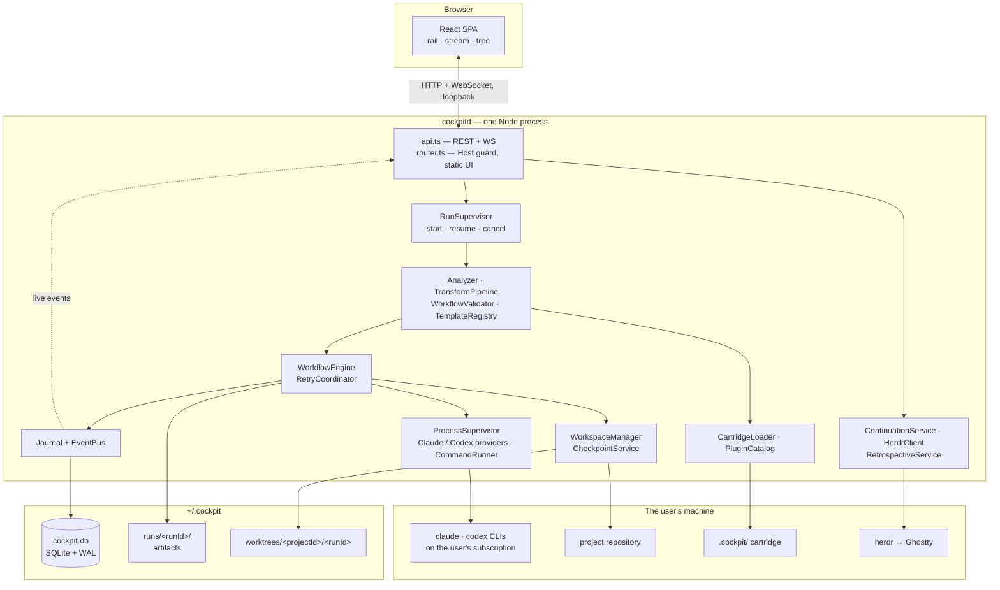
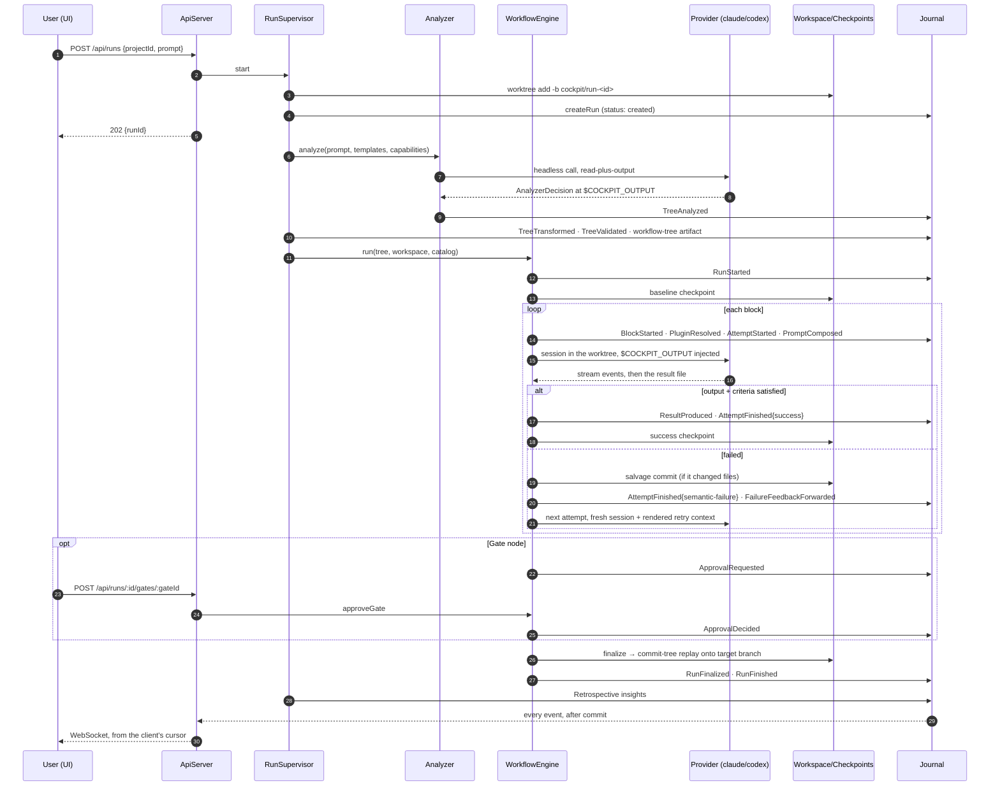
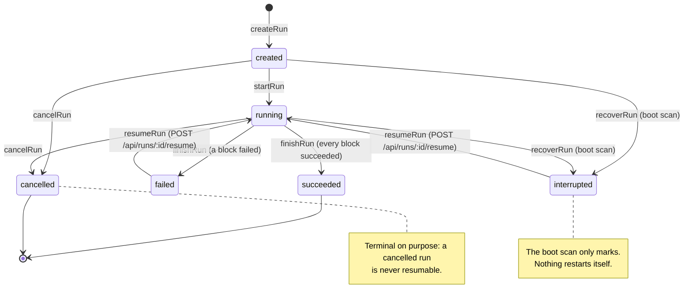

# Architecture

## The three layers

| Layer | Where | What it is |
|---|---|---|
| **Daemon** | `apps/cockpitd/` | One long-lived Node process. Builds the whole service graph as a single composed Effect `Layer`, owns all state and all child processes, serves REST + WebSocket on loopback, and serves the built UI as static files. |
| **Core engine** | `packages/core/` | Every service: journal, workspaces, providers, workflow interpretation, retries, cartridge loading, continuity, retrospective. Ships no knowledge of any specific project. |
| **UI** | `apps/ui/` | React 19 + Vite + Tailwind SPA. Reads the journal over HTTP and WebSocket, folds events into view state, renders three panels. |
| **Cartridge kit** | `packages/cartridge-kit/` | The authoring surface a project's `.cockpit/` imports: `defineCartridge()`, re-exported types, `blockId()`, `blocksIn()`, `ValidationError`. |

Process model: one daemon (`cockpitd`) plus a browser tab at `http://127.0.0.1:4177`. The daemon binds
loopback only. Closing the tab never affects a run — runs are forked into the daemon's own scope.

## Directory tree

```
cockpit-harness/
  apps/
    cockpitd/src/
      main.ts        # layer composition + NodeRuntime.runMain
      router.ts      # HttpRouter, Host guard, static UI serving
      api.ts         # REST handlers + WebSocket stream
      runs.ts        # RunSupervisor: start / resume / cancel, planning pipeline
      cli.ts         # `cockpit` client CLI: add / projects, over the same loopback API
    ui/
      src/           # React SPA (see table below)
      e2e/           # Playwright specs (smoke, insights, screenshots)
  packages/
    core/
      src/           # every engine service (see table below)
      test/          # vitest suites, fake CLIs, recorded stream fixtures
    cartridge-kit/src/index.ts
  docs/
    cockpit-plan.md  contracts.md  adr.md  acceptance-plan.md  claude-design-prompt.md
    about/           # this documentation
  scripts/refresh-fixtures.sh
  .github/workflows/ci.yml
```

## Daemon (`apps/cockpitd/src/`)

**`main.ts`** builds the runtime. `RecoveryScanLive` sits on top of `RunSupervisorLive` on top of
`RetrospectiveLive` (which transitively pulls in continuity, planning, engine and kernel);
`DaemonLockLive` is provided *underneath* all of it so a second daemon is refused before it opens the
journal; `NodeContext.layer` supplies the platform services. The HTTP layer is
`serveRoutes` over `makeRoutesLayer()` over `HttpServer.withLogAddress(ServerLive)`, and the whole
thing is launched with `NodeRuntime.runMain(Layer.launch(...))` — so migrations and the recovery scan
finish before the first request can be served. The server reads `COCKPIT_PORT` (default `4177`) and
hard-codes the host to `127.0.0.1`.

**`router.ts`** exposes `GET /healthz`, mounts `apiRoutes`, 404s any unmatched `/api/*`, and serves
the built UI for everything else with path containment and an SPA fallback to `index.html`. The
`localOnly` middleware rejects any request whose `Host` header is not a loopback name with
`403 {"error":"forbidden","detail":"cockpit serves loopback hosts only"}` — because binding
`127.0.0.1` does not stop DNS rebinding, and neither a WebSocket nor a `text/plain` form post is
subject to CORS.

**`api.ts`** holds every route handler. All request bodies are `Schema`-validated; every failure
answers in JSON. The WebSocket handler additionally checks the browser's `Origin` (absent means a
non-browser client, which no page can forge), subscribes to the bus *before* backfilling so no event
falls into the gap, pages the backfill 500 events at a time, then forwards live events with
`seq > cursor` and sends a JSON heartbeat every 30 s.

**`runs.ts`** is the `RunSupervisor`. `start` creates the worktree inside the request (so a bad
repository is the caller's error), writes the run row, and forks the run. The forked body loads the
cartridge, builds the registry, calls the Analyzer, applies transforms, writes the executed tree as a
`workflow-tree` artifact, and hands it to the engine. `resume` reads that artifact back, builds a
`ResumePlan`, flips the run to `running` (which is also the claim that prevents a second concurrent
resume), reconciles the worktree, and re-enters the engine. `cancel` interrupts the fiber if this
daemon owns it. A supervising wrapper turns interruption into `RunCancelled` and any other failure
into a journaled `ErrorRaised` plus `RunFinished{failed}`, and a finished run triggers the
retrospective.

### HTTP surface

| Method + path | Purpose |
|---|---|
| `GET /healthz` | `{"status":"ok"}` |
| `GET /api/projects` | Registered projects |
| `POST /api/projects` | Register `{name, repoPath}`; the git *root* is stored, 400 if not a repo |
| `GET /api/projects/:id/runs` | Runs of a project, newest first |
| `POST /api/runs` | Start `{projectId, prompt}` → `202 {runId}` |
| `GET /api/runs/:id` | Run row + executed tree + per-policy `maxAttempts` + block rows |
| `GET /api/runs/:id/events` | Journal page: `?from=<seq>&limit=<n>` (default 1000, max 5000) |
| `POST /api/runs/:id/gates/:gateId` | `{approved, note?}`; 409 if no gate is awaiting a decision |
| `POST /api/runs/:id/questions/:blockId` | `{answer}`; 409 if no question is parked |
| `POST /api/runs/:id/cancel` | 409 if the run is not executing in this daemon process |
| `POST /api/runs/:id/terminal` | Open or resume the canonical session; 502 on a terminal failure |
| `POST /api/runs/:id/retrospective` | 409 while the run is `created` or `running` |
| `POST /api/runs/:id/resume` | Re-enter; `202 {runId}`, 409 unless `interrupted` or `failed`, 404 unknown |
| `GET /api/insights` | `?target=core\|cartridge&limit&offset` |
| `GET /api/insights/:id` | One insight |
| `GET /api/runs/:id/blocks/:blockId/attempts` | Attempts of a block instance |
| `GET /api/attempts/:id` | One attempt row |
| `GET /api/artifacts/:id` | Artifact row |
| `GET /api/artifacts/:id/raw` | Artifact bytes; 413 over 1 MiB |
| `GET /api/ws` | WebSocket event stream: `?runId=<id>&from=<seq>` |

## Core engine (`packages/core/src/`)

| File | Responsibility |
|---|---|
| `config.ts` | `COCKPIT_HOME` config value and `ensureCockpitHome` (creates the directory). |
| `ids.ts` | Branded id schemas: `RunId`, `BlockId`, `AttemptId`, `SessionId`, `CheckpointId`, `ArtifactId`, `EventSeq`. |
| `errors.ts` | The tagged error hierarchy — `JournalError`, `ProcessError`, `ProviderError`, `WorkspaceError`, `ValidationError`, `DaemonError`, `CartridgeError`, `HerdrError`, `PreflightError`. No untyped throws anywhere. |
| `events.ts` | The event payload union (lifecycle payloads, which only `Journal` may emit, plus ancillary ones any service may append) and the fold helpers every consumer shares: `eventsOf`, `lastOf`, `errorCounts`, `pluginLabels`, `skipReasons`, `attemptFacts`. |
| `text.ts` | `clip` (surrogate-safe), `oneLine`, `renderSlots` (`{{param}}` substitution), `outputBudget` (1 MiB), and `fitSections` — the section-floor budgeting used by both the task brief and the retrospective summary. |
| `Db.ts` | SQLite client layer (WAL on, `~/.cockpit/cockpit.db`), the `PRAGMA foreign_keys = ON` that must land before the migrator, and migrations `0001_initial`, `0002_target_branch`, `0003_run_scoped_blocks`. |
| `Journal.ts` | The guarded state machine. Every write checks the current status, updates the row and inserts its event **inside one transaction**, and publishes to the bus only after it commits. A caller's own open transaction is refused outright. |
| `EventBus.ts` | Unbounded `PubSub` fan-out of journal events; `subscribe` is scoped so a subscription registers on acquire. |
| `Store.ts` | The read side of the journal tables for the API, plus project registration (the one write no event narrates). |
| `ArtifactStore.ts` | Writes run artifacts under `~/.cockpit/runs/<runId>/`, records them through `Journal`, and reads back `$COCKPIT_OUTPUT` with size and symlink checks. |
| `Recovery.ts` | The boot scan: mark orphaned attempts and running blocks `interrupted`, then close the run as `interrupted` with its last **success** checkpoint. Marking only. |
| `DaemonLock.ts` | Exclusive `~/.cockpit/daemon.pid` claim with stale-pid reclaim; released on scope close. |
| `Workspace.ts` | `WorkspaceManager` (worktree `create` / `restore` / `reconcile` / `remove` / `resolveRepo`) and `CheckpointService` (`checkpoint`, `salvage`, `rollbackTo`, `changedFiles`, `finalize`). All git runs through one bounded, timeout-guarded helper under a single lock. |
| `ProcessSupervisor.ts` | Scoped child spawn in its own process group, empty stdin (so a CLI that reads stdin sees EOF), per-child timeout, and a `SIGTERM` → grace → `SIGKILL` tree kill on scope close. |
| `Provider.ts` | The `Provider` interface, permission profiles, the normalized `ProviderEvent` union, line-budgeted stream plumbing (`runProvider`), and `runToResult`. |
| `ClaudeCodeProvider.ts` | `claude -p --output-format stream-json --verbose …` argv, permission-mode mapping, and the stream-json parser (including `AskUserQuestion` → `QuestionAsked`). |
| `CodexProvider.ts` | `codex exec --json …` argv with `-c` sandbox overrides, and the JSONL parser. |
| `CommandRunner.ts` | Command blocks: spawn, capture bounded stdout/stderr, evaluate `OutputRule`s (`StdoutMatches`, `StderrMatches`, `ArtifactExists`), journal `CommandExecuted`. |
| `workflow.ts` | The data model: `WorkflowNode` union, `BlockDef`, `RetryPolicy`, `PluginBinding`, `ContractField`, predicates and success criteria, plus `evaluateCheck` and `contractProblems`. |
| `blocks.ts` | Core block definitions — `agent-task`, `verify-output`, `run-command`, `finalize` — and core policies `single-attempt` and `corrective`. |
| `templates.ts` | Core workflow templates: `task`, `quickfix`, `guarded-fix`. Core templates bind no plugins. |
| `cartridge.ts` | The `Cartridge` schema and the `TreeTransform` / `TreeValidator` function types. |
| `TemplateRegistry.ts` | Merges core and cartridge catalogs: cartridge templates are namespaced `<name>/<id>`, block ids share one namespace and a collision is refused, retry policies override by id. |
| `WorkflowValidator.ts` | Walks the tree in execution order and rejects: unknown blocks or policies, duplicate ids, wrong-kind blocks, non-positive timeouts, escaping artifact globs, unsatisfied input contracts, parallel write conflicts, malformed predicates, loops without exits, and double-retry hazards. |
| `Analyzer.ts` | Composes the analyzer prompt, runs it headlessly with the `read-plus-output` profile, decodes and checks the decision, retries once with the exact rejection, falls back to template defaults, then `instantiate`s the template (prune optional blocks, apply bindings, derive per-loop policies, substitute params). |
| `TransformPipeline.ts` | Runs cartridge transforms in declared order, journals a field-level `treeDiff` per transform as an artifact, then runs cartridge validators plus `validateWorkflow` and journals `TreeValidated`. |
| `CartridgeLoader.ts` | Loads `.cockpit/cockpit.config.ts` through `jiti`, decodes it against the schema, resolves `promptFile` (with symlink-aware containment), hashes every non-`node_modules` file under `.cockpit` length-prefixed, and watches the directory to mark the cache stale. |
| `PluginCatalog.ts` | Discovers installed Claude Code plugins and their entries, probes provider `--version` (cached for the daemon's lifetime), and runs per-block preflight producing a `PreflightResult` or a typed `PreflightError`. |
| `WorkflowEngine.ts` | The interpreter. Walks the tree; runs agent, command and workspace blocks; composes prompts and envelopes; drives question suspend/resume; parks gates on `Deferred`s; verifies output contracts and success criteria; takes checkpoints and salvage commits; and, on re-entry, replays finished blocks instead of executing them. |
| `RetryCoordinator.ts` | `withTechnicalRetries` (an Effect `Schedule` with capped exponential backoff, bounded separately at 3) and `semanticLoop` (attempt counting, packet accumulation, no-progress detection, human gates, rollback, loop timeout). |
| `failure.ts` | `buildFailurePacket`, `failureSignature` (volatile parts normalized away), and `buildRetryContext` / `renderRetryContext` — the ordered reductions that fit a context to its budget without ever cutting mid-structure. |
| `Resume.ts` | `buildResumePlan` — folds the journal into per-node facts once, before execution — plus `iterationOpen` and `resumedIteration`, which decide where a loop carries on. |
| `Continuation.ts` | The canonical session lifecycle: worktree presence or `restore`, resume probe, brief assembly, terminal handoff, and the journal writes that happen only after a terminal actually took the session. |
| `brief.ts` | `renderTaskBrief` — pure: journal events in, budgeted Markdown out. |
| `Herdr.ts` | Drives `herdr status server --json`, `herdr tab create`, `herdr pane run` through the CLI, with `open -na Ghostty.app` as the fallback. |
| `Retrospective.ts` | `renderRunSummary` (pure), the insight agent call, normalized dedup keys, evidence-merging upsert capped at 40 entries, and the insight queries. |
| `index.ts` | Re-exports everything and defines the layer bundles: `KernelLive` → `EngineLive` → `PlanningLive` → `ContinuityLive` → `RetrospectiveLive`. |

## UI (`apps/ui/src/`)

| File | Role |
|---|---|
| `main.tsx` | React root. |
| `App.tsx` | The three-panel shell: header with status/elapsed/actions, rail, stream, tree, idle screen, global keyboard handling, and every action callback. |
| `Rail.tsx` | Left rail: project picker and add-project form, run list with status glyphs, new-task button, recent activity, insights toggle. |
| `Stream.tsx` | Center panel: virtualized (`virtua`) event stream with expandable rows, approval cards, question cards, attempt headers, failure summaries, artifact viewers. |
| `Tree.tsx` | Right panel: the workflow tree with per-node status, durations, loop attempt indicators, and block selection that filters the stream. |
| `Insights.tsx` | The retrospective insights view with `all` / `core` / `cartridge` filters and detail. |
| `model.ts` | The daemon's contracts mirrored by hand as plain TypeScript, deliberately, so `effect` is not pulled into the browser bundle for types alone. |
| `api.ts` | `httpSource`: fetch wrappers, paged event backfill, the reconnecting WebSocket with exponential backoff, the artifact reader (413 → "too large" message), and the answer POST that backs off through the 409 window. |
| `store.ts` | `applyEvents` — the pure fold from journal events to `RunState` (run status, blocks, attempts, pending gates, pending questions) — and the `useEventStore` hook that backfills then subscribes. |
| `presentation.ts` | `describe` (one event → tag, tone, summary), `buildRows` (events → stream rows with caching so settled rows never remount), duration/clock formatting, diff parsing, and the resume/terminal copy. |
| `treeModel.ts` | `flattenTree`, `loopIndicator` (the `2/3`-style ticks), `maxAttemptsByBlock`. |
| `insightModel.ts` | Insight row → view model. |
| `render.tsx` | The heavy renderers: `shiki` code highlighting, xterm-backed ANSI, diff, Markdown, and the artifact body dispatcher. |
| `mock.ts` | The `?mock=<state>` harness: a complete in-memory `Source` for every UI state, used by Playwright and by hand. |
| `index.css` | Tailwind theme: the dark palette (`bg`, `panel`, `surface`, `head`, `ink*`, `vio`, `blue`, `green`, `amber`, `red`, `slate`) and fonts. |

## Data flow

```
prompt
  → Analyzer            (headless provider call → AnalyzerDecision → instantiated tree + derived policies)
  → TransformPipeline   (cartridge transforms in order, each diffed and journaled)
  → validators          (cartridge validators + validateWorkflow → TreeValidated)
  → workflow-tree artifact written
  → WorkflowEngine      (walk the tree)
      → per block: preflight → prompt/envelope → provider session or command
      → output contract + success criteria checked
      → checkpoint on success, salvage on a failed attempt that changed files
      → failure packet → budgeted retry context → next attempt
  → finalize            (success checkpoints replayed onto the target branch)
  → RunFinished
  → Retrospective       (journal summary → insights, deduplicated)
```

**Journal-first is the load-bearing invariant.** Nothing is reported outward before it is durable.
A state change and the event that narrates it are written in one SQLite transaction; only after that
transaction commits is the event published to the in-process `EventBus`; only from the bus does it
reach WebSocket clients, each holding its own monotonic `seq` cursor. A reconnecting UI re-pages from
its cursor and then goes live. No event exists only in memory, which is exactly why a `kill -9` leaves
a journal that can be read back and re-entered.

## Key entities

| Entity | What it is |
|---|---|
| **Run** | One prompt against one project. Owns a worktree, a branch (`cockpit/run-<runId>`), a base commit, a target branch, and an artifact directory. |
| **Block** | One instance of a block definition inside one run. Its id is per-run and gains a suffix on re-execution: `implement`, `implement#2`. |
| **Attempt** | One execution of a block. Carries a session id (agent blocks), a verdict, and its own artifacts. |
| **Checkpoint** | A git commit in the run's worktree, `success` or `salvage`. |
| **Artifact** | A file under `~/.cockpit/runs/<runId>/` with a row pointing at it: prompts, transcripts, block outputs, failure packets, tree diffs, command logs, gate payloads, plugin state, the task brief, the workflow tree. |
| **Event** | An append-only journal row with a monotonic `seq`, optionally naming a block and an attempt. |
| **Insight** | A deduplicated retrospective finding targeting `core` or `cartridge`, with evidence and an occurrence count. |

### SQLite schema (contracts §10)

```sql
projects    (id, name, repo_path, cartridge_hash, created_at)
runs        (id, project_id, prompt, status, base_commit, worktree_path, branch, target_branch,
             provider_versions_json, plugin_versions_json, cartridge_hash,
             canonical_session_id, created_at, finished_at)
blocks      (id, run_id, def_id, kind, status, started_at, finished_at,
             PRIMARY KEY (run_id, id))
attempts    (id, run_id, block_id, number, session_id, verdict, result_json,
             started_at, finished_at,
             FOREIGN KEY (run_id, block_id) REFERENCES blocks (run_id, id))
events      (seq INTEGER PRIMARY KEY AUTOINCREMENT, run_id, block_id, attempt_id, ts, payload_json)
artifacts   (id, run_id, kind, path, bytes, created_at)
checkpoints (id /* git sha */, run_id, block_id, attempt_id, kind, created_at)
insights    (id, dedup_key UNIQUE, target, title, body, evidence_json,
             occurrences, first_seen_run, last_seen_run)
```

Migration `0003` rebuilds `blocks` and `attempts` because a `BlockId` is unique only inside its run —
a global `blocks.id` primary key made the second run of any template collide at its first block.
`attempts` gained `run_id` for the composite parent key, which also removed the join every attempt
read previously needed.

## Diagrams

### Components



### A run, end to end



### Run status



Blocks have their own statuses — `running`, `succeeded`, `failed`, `skipped`, `interrupted` — and
attempts carry a verdict of `success`, `semantic-failure`, `technical-failure`, `interrupted` or
`cancelled`.

## Where to read further

- `docs/contracts.md` — every typed contract in full, with the "settled in Phase N" notes that record
  how each open question was decided. Section 9 is the authoritative account of run re-entry;
  section 10 the persistence schema; section 11 the cartridge surface; section 12 the task brief.
- `docs/adr.md` — ADR-001..008, each with the alternatives that were rejected and why: local daemon +
  browser UI, custom SQLite journal (over Temporal and `@effect/workflow`), hybrid analyzer, fresh
  session per attempt, worktree per run, v1 scope, `jiti` cartridge loading, canonical continuation
  session.
- `docs/cockpit-plan.md` — the product and implementation plan the code was built against, including
  the §17 acceptance criteria.
